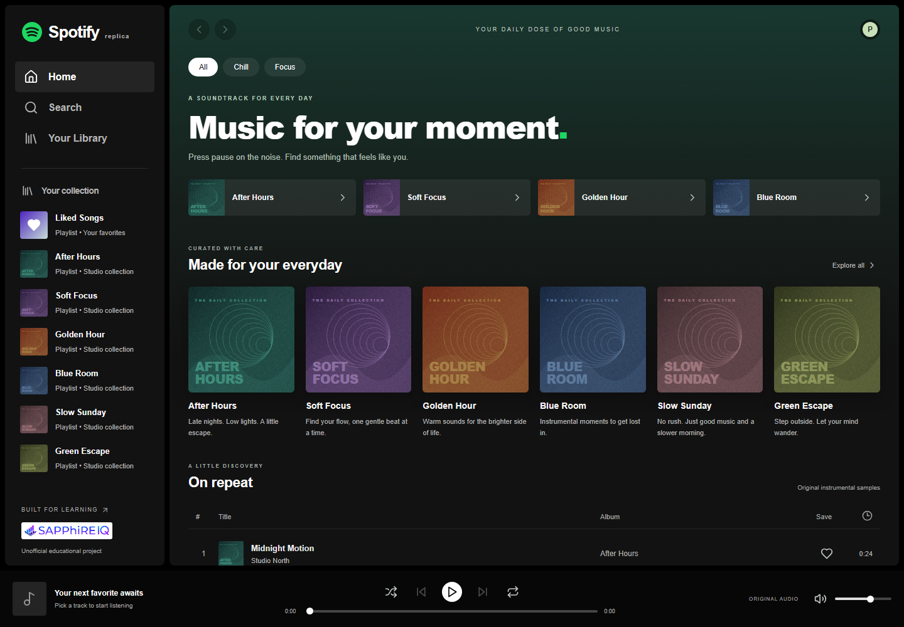
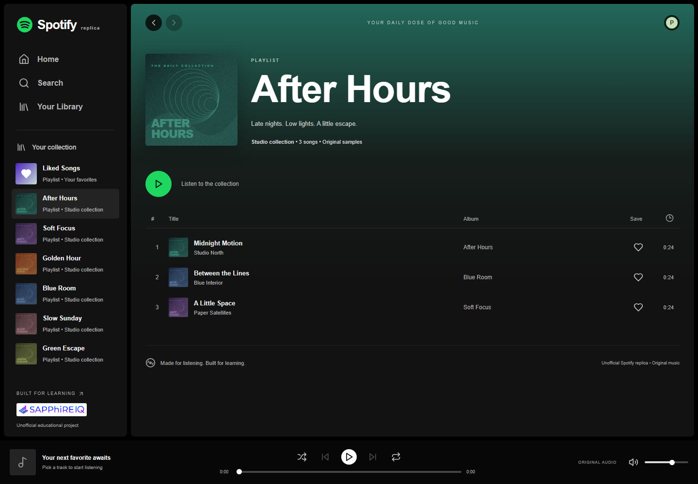
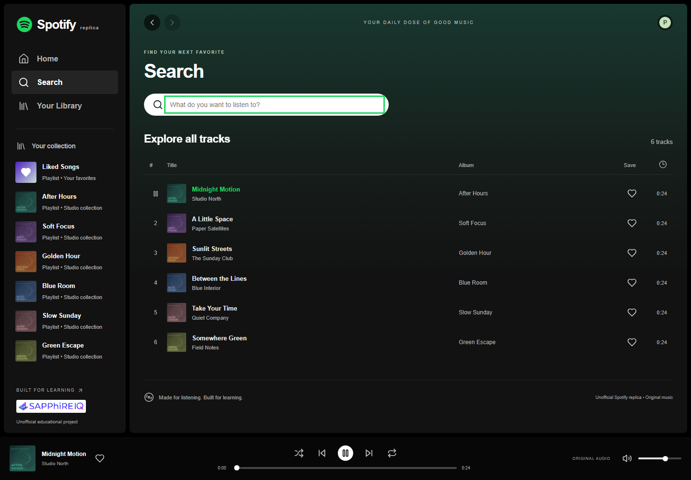
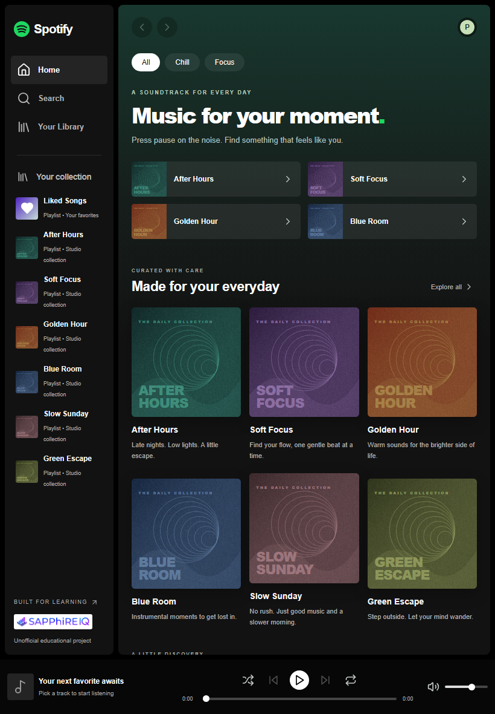
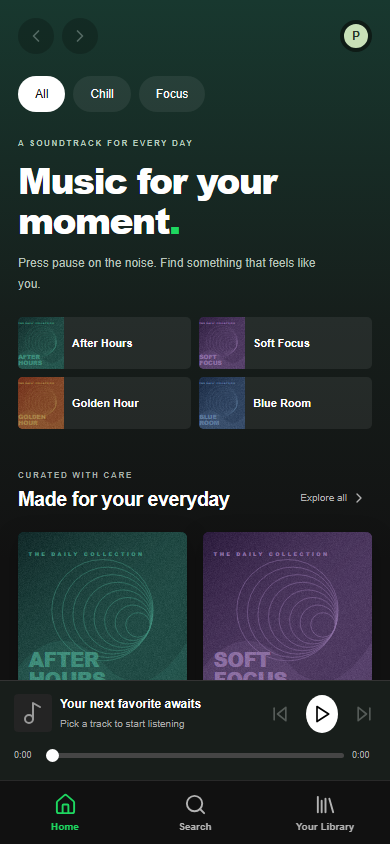
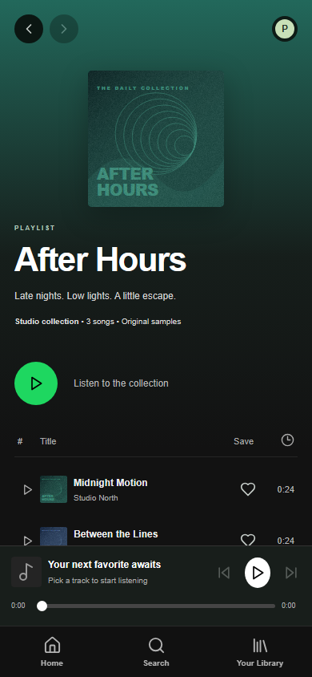

# Spotify Replica

An **unofficial educational Spotify-style replica**, built for the SapphireIQ front-end assignment. This project is not affiliated with or endorsed by Spotify. It uses React, plain CSS, the HTML5 Audio API, and React Context; it does not connect to Spotify services.

## Screenshots

Actual app screenshots captured in Chromium. The desktop and tablet layouts use a sidebar; mobile uses bottom navigation and a compact persistent player.

### Desktop home



### Playlist view



### Search with the persistent player



### Tablet



### Mobile

| Home                                                                                                                                 | Playlist                                                                                                                                 |
| ------------------------------------------------------------------------------------------------------------------------------------ | ---------------------------------------------------------------------------------------------------------------------------------------- |
|  |  |

Screenshots are stored in `docs/screenshots/` and included in Git so they display on GitHub.

## Run locally

Use Node.js **22.12 or newer** (Node 24 recommended) and npm.

```sh
npm ci
npm run dev
```

Open the URL printed by Vite, normally <http://127.0.0.1:5173>. No credentials, environment variables, backend, or API keys are required.

```sh
npm run build
npm run preview
```

The production build is written to `dist/`; preview normally runs at <http://127.0.0.1:4173>. Serve the app with Vite or a static HTTP server rather than opening `index.html` directly. All music, covers, and logos are local assets.

## Implemented features

- Desktop sidebar, top navigation, home collections, playlist pages, library, and liked songs.
- Data-driven playlist cards and track lists built from reusable React components and props.
- Track selection and playlist playback; persistent now-playing bar across all views.
- Real HTML5 audio play/pause, previous/next, seek, event-driven progress and duration updates, automatic advancement, shuffle, repeat, volume, and mute.
- Search by track title, artist, or album, with case-insensitive matching and an empty-result state.
- Local favorites saved in browser storage, plus empty-library guidance.
- App back/forward controls and hash-based view links that survive a page refresh.
- Responsive desktop, tablet, and mobile layouts. Mobile navigation sits below a compact persistent player.
- Semantic landmarks, labeled controls, keyboard activation, keyboard-adjustable sliders, a skip link, visible focus outlines, and reduced-motion support.
- Helpful messages for blocked playback and unavailable audio.

Click a cover to open its playlist. Use the large playlist Play button, a track's play button, or its title to start audio. The player operates on the list from which you selected the track; next/previous wrap within that queue. Previous restarts the current track when playback is beyond three seconds, otherwise it selects the previous track. Repeat loops the current track; shuffle chooses another track in the queue. Hearts save or remove tracks.

On mobile, the compact player retains play/pause, previous/next, and seek. Optional shuffle, repeat, and app volume controls are shown on wider layouts; device volume remains available on mobile. Tracks can still be saved using their row hearts.

## Assignment alignment

The supplied eight-page `SapphireIQ_Spotify_Replica_Logo_Updated_FINAL.pdf` was read in full and all pages were visually inspected before implementation. Its stack is React + CSS/Tailwind + HTML5 Audio, with Context for shared state. Plain CSS is the chosen permitted styling option, and Vite is the build tool.

| PDF checkpoint                                                          | Implementation                                                                     |
| ----------------------------------------------------------------------- | ---------------------------------------------------------------------------------- |
| Module 1: sidebar, top nav, main areas, Grid/Flexbox, responsive design | `App`, `Sidebar`, CSS Grid/Flexbox, desktop/tablet/mobile media queries            |
| Module 2: playlists, selected tracks, list rendering, props             | Static catalog, `PlaylistCard`, `TrackList`, `playlistTracks()`                    |
| Module 3: play/pause, next/previous, progress, `useRef`, audio events   | `PlayerContext`, one HTML5 `<audio>` element, `PlayerBar`, seek and event handlers |
| Module 4: search/filter, Context, persistent now playing                | `SearchView`, `filterTracks()`, root `PlayerProvider`, persistent `PlayerBar`      |
| Outcome: Sidebar/Nav, TrackList, PlayerBar sharing current track        | Components read the same root Context while views change                           |

The guide mentions matching a target design but does **not** contain a Spotify interface screenshot, precise app spacing/color/font specification, or a separate app-logo instruction. The interface therefore uses a consistent Spotify-inspired dark theme, green controls, system Arial/Helvetica typography, and original geometric covers. The actual updated SapphireIQ logo embedded in the PDF is included for assignment attribution without recreating or altering the logo itself. There is no additional authentication, API, or backend requirement in the guide. See [the detailed checklist](docs/assignment-checklist.md).

## Project structure

```text
src/
  App.jsx                     view navigation and page composition
  main.jsx                    root provider and React entry point
  components/                 sidebar, views, cards, track list, player
  context/PlayerContext.jsx   shared state and HTML5 audio lifecycle
  data/catalog.js             track/playlist data and filtering helpers
  styles.css                  styling and responsive breakpoints
public/
  audio/                      six original WAV samples
  covers/                     six original SVG illustrations
  brand/                      assignment attribution logo
scripts/generate-assets.py    reproducible music/cover generator
tests/                       Node unit tests and Playwright browser tests
docs/assignment-checklist.md  requirement-by-requirement review
```

To add your own permitted audio, place files in `public/audio/` and update `src/data/catalog.js` with metadata and the public URL. Playlist track IDs must refer to entries in `tracks`. Do not place credentials in frontend source.

## Verification

```sh
npm test
npx playwright install chromium
npm run test:e2e
npm run format:check
npm run build
```

Playwright starts the local Vite server automatically or reuses one already running at port 5173. Browser results are stored in ignored `test-results/`; verification screenshots are stored in ignored `.tools/screenshots/`.

Completed checks:

- Three Node unit tests: search matching, playlist ordering and local asset existence, playback time formatting.
- Nine Playwright browser tests: audio time progression and pause, navigation persistence, search, saved favorites across refresh, seek, previous/next, shuffle/repeat, mute/volume, ended events, and playback failure messages.
- Desktop 1440×1000, tablet 820×1180, mobile 390×844, and small mobile 320×740: image loading, horizontal overflow, navigation, keyboard skip link, and playback across views.
- Axe accessibility scans against WCAG 2 A/AA and 2.1 A/AA tags on home, playlist, search, library, and liked-song views at desktop and mobile widths.
- Visual review of browser screenshots, source formatting, production build, and npm dependency audit.

Automated accessibility checks do not replace a full assistive-technology audit. Browser tests verify media decoding, events, and time progression; physical speaker output and Safari/Firefox were not tested. No connected interactive browser was available, so verification used Playwright Chromium and inspected screenshots.

## Assets and credits

- `public/covers/*.svg`: original geometric cover illustrations created for this project; reproducible with `python scripts/generate-assets.py`.
- `public/audio/*.wav`: six original synthesized instrumental samples, each 24 seconds, created by the same standard-library Python script. The artists and titles are fictional. No copyrighted songs were downloaded.
- `public/brand/sapphireiq.png`: updated SapphireIQ logo extracted from the user-supplied assignment PDF, retained as educational attribution. It remains the property of its respective owner; no public redistribution license is asserted.
- `public/favicon.svg`: locally drawn Spotify-style educational mark. Spotify branding remains the property of Spotify.
- UI icons: [Lucide](https://lucide.dev), distributed under its ISC license.
- Typography: locally available system Arial/Helvetica/sans-serif; no remote font requests.

React/React DOM and Lucide license notices are included in `public/THIRD-PARTY-NOTICES.txt` and copied into the production build.

Original generated cover artwork and audio may be reused as project samples. Third-party brand assets are not included in that permission.

## Limitations

This is an assignment music player, not the full Spotify service. It has six short original samples and six static curated playlists. Playback survives view navigation, but intentionally does not autoplay or restore playback after a refresh. Favorites persist on this browser/device when storage is available; they do not sync to an account. Browser media policies can require a user gesture, and the player displays a message when playback is blocked. Hash links identify views; the header arrows maintain this app's own view history. The app is intended to be served from the domain root.

## Git

The supplied remote is `https://github.com/poojaaxx/spotify-replica`. It was empty when inspected. Development stages are committed locally with the user-confirmed identity. Dependencies, builds, temporary tools/screenshots, and environment files are ignored. **Nothing has been pushed.**
